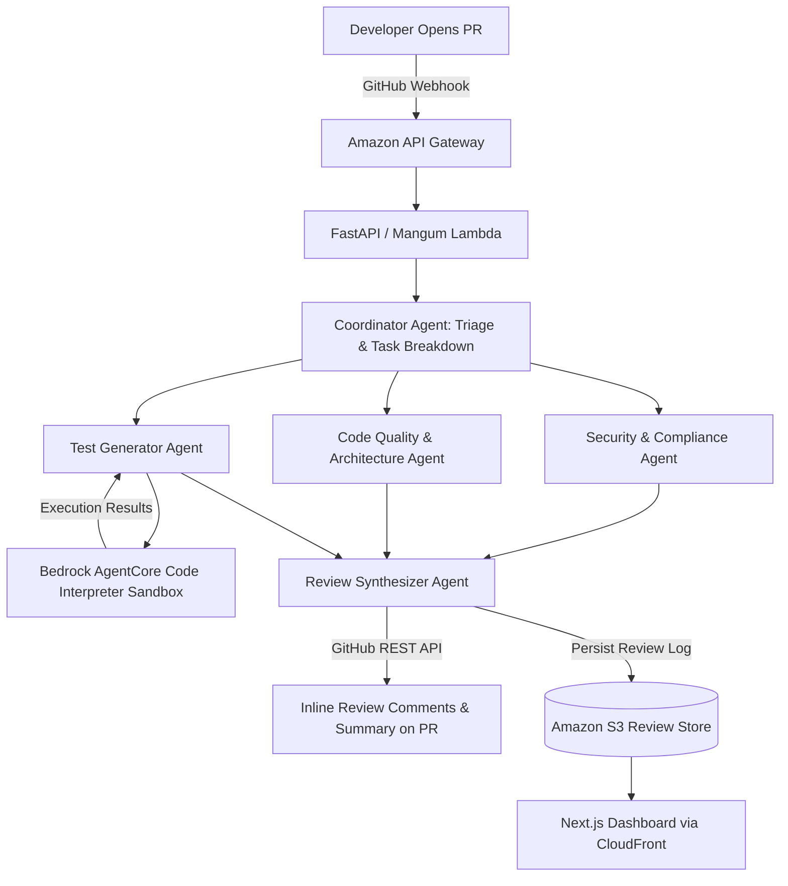

# Multi-Agent Pull Request Reviewer & Automated Unit Tester

A production-ready, autonomous multi-agent system built on **Amazon Bedrock**, **Bedrock AgentCore**, and **Strands Agents**. It connects to GitHub repositories via webhooks, coordinates specialized AI agents to inspect incoming Pull Requests, runs generated unit tests inside an isolated **Bedrock Code Interpreter** execution sandbox, and posts comprehensive inline code reviews and test reports directly back to GitHub.

---

## 🔗 Links

- **Live Dashboard:** `https://<your-cloudfront-id>.cloudfront.net/`
- **GitHub Repository:** `https://github.com/<your-username>/<your-repo-name>`

<br />


---

## 💡 Overview

When a Pull Request is opened or updated in GitHub, this application triggers a team of specialized AI agents running on AWS:



1. **Coordinator Agent:** Parses the PR diff, context, and commit history; decomposes review duties across specialized sub-agents.
2. **Security & Vulnerability Agent:** Scans for hardcoded secrets/API keys, SQL/command injection vulnerabilities, OWASP Top 10 risks, and overly permissive IAM/cloud configurations.
3. **Code Quality & Architecture Agent:** Evaluates code against idioms, performance hotspots, breaking API changes, and modular design patterns.
4. **Unit Test Generator & Sandbox Runner:** Drafts edge-case unit tests using `pytest` / `unittest`, invokes the **Bedrock AgentCore Code Interpreter** to execute the tests in a real Python sandbox, and reports pass/fail diagnostics.
5. **Review Synthesizer & GitHub Reporter:** Formats findings into an interactive markdown summary, posts inline file diff comments using the GitHub API, and assigns an approval score (`APPROVE`, `COMMENT`, or `REQUEST_CHANGES`).

---

## 🚀 Core Features

- **Automated Webhook Ingestion:** Secure webhook validation via GitHub HMAC secret signatures (`X-Hub-Signature-256`).
- **Multi-Agent Orchestration:** Strands-based agent collaboration powered by AWS Bedrock (`anthropic.claude-3-5-sonnet` / `amazon.nova-lite-v1:0`).
- **Live Sandboxed Code Execution:** Tests are dynamically executed using **Amazon Bedrock AgentCore Code Interpreter Client** to verify test validity before reporting.
- **GitHub Inline Review Comments:** Feedback is mapped directly to diff file paths and line ranges.
- **Audit History & S3 Persistence:** Every PR review, prompt trace, and execution log is stored in Amazon S3 by repository and PR number.
- **Web Dashboard:** Next.js static site hosted on S3 and delivered globally through Amazon CloudFront with Tailwind CSS dark-mode UI.
- **Enterprise-Grade Infrastructure as Code:** 100% codified with Terraform across multiple environments (`dev`, `prod`) using S3 remote backend state and DynamoDB state locking.
- **CI/CD with GitHub Actions:** Automated linting, container builds, and zero-credential OIDC deployments to AWS.

---

## 🛠️ Tech Stack

| Layer | Technology | Description |
|---|---|---|
| **Agentic AI & LLM** | AWS Bedrock, Strands Agents, Bedrock AgentCore | Multi-agent loop, prompt orchestration, and Code Interpreter |
| **Backend API** | FastAPI, Python 3.12, Mangum | Serverless REST API handling webhooks & dashboard queries |
| **Compute & Gateway** | AWS Lambda, Amazon API Gateway (HTTP API) | Serverless compute with auto-scaling and sub-second cold starts |
| **Frontend UI** | Next.js 16, React 19, Tailwind CSS v4, TypeScript | Static dashboard for monitoring repository review health |
| **Storage & CDN** | Amazon S3, Amazon CloudFront | Secure storage for PR review artifacts and global CDN edge delivery |
| **Infrastructure as Code** | Terraform (S3 Remote Backend + State Locks) | Automated infrastructure provisioning |
| **CI/CD** | GitHub Actions with AWS OIDC Role Federation | Keyless, automated deployment pipeline |

---

## 📁 Project Structure

```text
multi-agent-pr-reviewer/
├── backend/
│   ├── app/
│   │   ├── agents/
│   │   │   ├── coordinator.py      # Task breakdown & plan orchestration
│   │   │   ├── security.py         # Vulnerability & secret scanning agent
│   │   │   ├── code_quality.py     # Architecture & performance review agent
│   │   │   ├── test_runner.py      # Test generation + Bedrock Code Interpreter
│   │   │   └── reporter.py         # Markdown generator & GitHub API poster
│   │   ├── core/
│   │   │   ├── config.py           # Environment variables & Bedrock client setup
│   │   │   └── github_client.py    # GitHub REST/GraphQL API integration
│   │   ├── services/
│   │   │   └── s3_storage.py       # S3 session & review persistence
│   │   └── main.py                 # FastAPI application & webhook endpoint
│   ├── Dockerfile
│   └── requirements.txt
├── frontend/
│   ├── app/
│   │   ├── layout.tsx              # Root dashboard layout
│   │   ├── page.tsx                # Repository overview & recent reviews
│   │   └── reviews/[id]/page.tsx   # Detailed PR breakdown with agent traces
│   ├── components/                 # Reusable UI cards, diff viewer, badges
│   ├── public/
│   └── package.json
├── terraform/
│   ├── main.tf                     # Lambda, API Gateway, S3, CloudFront
│   ├── variables.tf                # Environment variables & regional configs
│   ├── outputs.tf                  # API Gateway URL & CloudFront domain
│   └── backend.tf                  # S3 remote state configuration
├── .github/
│   └── workflows/
│       ├── deploy.yml              # CI/CD pipeline using AWS OIDC
│       └── destroy.yml             # Clean teardown workflow
└── README.md
```

---

## ⚙️ Quick Start & Local Setup

### Prerequisites

- Python 3.11+ / Python 3.12
- Node.js 18+ and `npm`
- AWS Account with Bedrock model access (`Claude 3.5 Sonnet` or `Amazon Nova Lite` in `us-west-2` or `us-east-1`)
- GitHub Personal Access Token (PAT) with `repo` permissions or a GitHub App

### 1. Backend Setup

```bash
cd backend
python -m venv .venv
source .venv/bin/activate  # Windows: .venv\Scripts\activate
pip install -r requirements.txt
```

Create a `.env` file in `backend/`:

```env
AWS_REGION=us-west-2
BEDROCK_MODEL_ID=anthropic.claude-3-5-sonnet-20241022-v2:0
GITHUB_TOKEN=ghp_your_github_personal_access_token
GITHUB_WEBHOOK_SECRET=your_webhook_secret_key
S3_BUCKET_NAME=your-pr-reviews-bucket
```

Run the backend server locally:

```bash
uvicorn app.main:app --reload --port 8000
```

### 2. Frontend Setup

```bash
cd frontend
npm install
npm run dev
```

Open [http://localhost:3000](http://localhost:3000) to view the dashboard.

---

## 🚢 Infrastructure Deployment (Terraform)

Deploy the entire AWS serverless stack with a single command:

```bash
cd terraform
terraform init
terraform workspace select -or-create dev
terraform apply -auto-approve
```

---

## 👨‍💻 Author

- **GitHub:** [@Chiru144](https://github.com/Chiru144)
